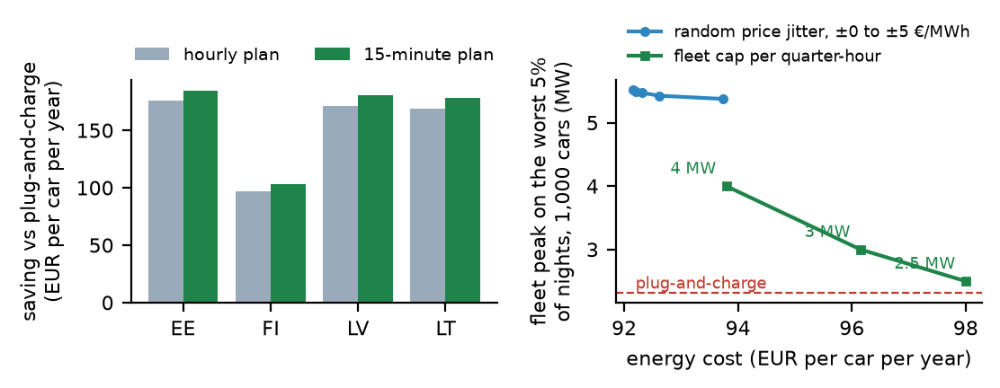

# quarterhour: smart EV charging after the switch to 15-minute day-ahead prices

On 1 October 2025 the Nordic and Baltic day-ahead market moved from hourly to 15-minute prices. This repo replays the first full year, 1 Oct 2025 – 30 Sep 2026 (35,040 quarter-hours, Elering open data), for Estonia, Finland, Latvia and Lithuania. It asks two questions about cloud-based smart charging:

1. **What is 15-minute resolution worth to one car**, compared with planning on hourly averages?
2. **What happens to the grid when 1,000 cars all chase the same cheapest quarter-hour**, and what does it cost to stop that?

```
pip install numpy matplotlib tzdata
python data/fetch.py                                  # one year of 15-minute prices from Elering
PYTHONPATH=src python -m quarterhour.experiments      # about 15 minutes, laptop CPU
```

**The cars.** Each car plugs in on 60% of nights: around 18:30 (sd 1.2 h), leaving around 07:15. It needs 5–18 kWh, from a 7.4 or 11 kW charger, which comes to 2,521 kWh per car per year. Costs are **wholesale energy only**: network fees, taxes and margins are the same for every strategy except time-of-use network tariffs, which are discussed under Limits.



## 1. One car: 15-minute planning adds about 5%

Wholesale energy cost per car per year:

| Zone | Plug-and-charge | Hourly plan | 15-minute plan | Extra from 15 minutes |
|---|---|---|---|---|
| EE | €276.79 | €101.24 | €92.28 | **€8.96** (4.9% of the €184.51 saving) |
| FI | €177.79 | €80.58 | €74.99 | €5.59 (5.4% of €102.80) |
| LV | €321.62 | €150.61 | €141.15 | €9.46 (5.2% of €180.47) |
| LT | €322.11 | €153.30 | €143.93 | €9.37 (5.3% of €178.18) |

Smart charging cuts the night's energy cost by about two thirds. Planning on the real 15-minute prices instead of hourly averages adds about €9 per car per year in the Baltics: real, but small next to the first €175.

## 2. A fleet: smart charging creates a new peak

Everyone optimising against the same price signal piles into the same quarter-hour. For 1,000 cars in Estonia:

| Strategy | Average nightly peak | Peak on the worst 5% of nights | Energy cost per car-year |
|---|---|---|---|
| Plug-and-charge | 2.14 MW | 2.32 MW | €276.49 |
| 15-minute plan, every car alone | **5.09 MW** | **5.51 MW** | €92.15 |
| … with random price jitter ±€5/MWh | 3.62 MW | 5.38 MW | €93.73 |
| … with a **fleet cap of 3 MW** per quarter-hour | 3.00 MW | 3.00 MW | €96.15 |
| … with a **fleet cap of 2.5 MW** per quarter-hour | 2.50 MW | **2.50 MW** | **€97.99** |

- **Smart charging multiplies the fleet's peak by 2.4.** A utility or network operator buying flexibility from the fleet sees a sharper peak, not a flatter one.
- **Random jitter fixes the average night but not the worst ones.** On the nights that matter most, one quarter-hour is much cheaper than the rest and every car still takes it: peak −29% on average but only −2.5% at the 95th percentile.
- **A fleet-aware cap fixes both, cheaply.** Cars take the cheapest slots that still have room under the cap. At 2.5 MW the worst-night peak falls 55%, for €5.84 per car per year: 3% of the smart-charging saving, and less than the 15-minute bonus from part 1.

## What this suggests for a smart-charging platform

The 15-minute switch is worth implementing but is not the big lever. The bigger operational question appears as soon as the platform has a fleet in one grid area: the platform itself creates the peak. A per-area cap on concurrent charging, scheduled fleet-wide rather than car by car, keeps almost all of the savings. It also gives a utility partner a number it can plan around.

## Limits

- **Prices.** Elering day-ahead prices for EE, FI, LV and LT only. Other bidding zones (SE, NO, DK) were not tested.
- **Wholesale only.** Estonian and Finnish network operators have day/night or time-of-use network tariffs. Those shift *which* hours are cheap, not the size of the 15-minute effect.
- **Synthetic cars.** Plug-in behaviour is a guess, not fleet data, and every car has a full price forecast for its window.
- **Greedy cap.** The fleet cap is a greedy, random-order assignment, not an optimal solution, so its cost is an upper bound.

Data: Nord Pool day-ahead prices as published by Elering (dashboard.elering.ee). Not included in the repo; `data/fetch.py` downloads them.

---

Mouadh Abderrahmane Assal · More in my [portfolio](https://mouadh.vercel.app/) · [github.com/mouadhassal](https://github.com/mouadhassal)
